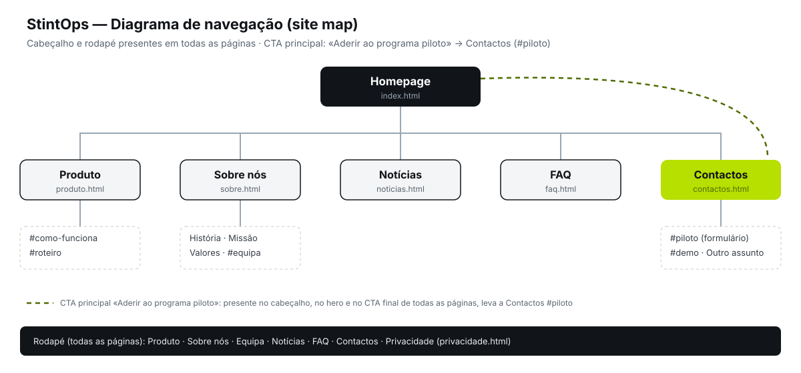

# StintOps — Estruturação do Website Corporativo

Empreendedorismo e Inovação I · Iscte · 2026/2027 · Grupo 14

Público-alvo: equipas de kart endurance, em especial quem gere a estratégia na box (chefe de equipa, pilotos, responsável de cronometragem).
Posicionamento: ferramenta de apoio à decisão transparente. Mostra os pressupostos e deixa a decisão final à equipa.
Tom: próximo e direto (tratamento por «tu»), com o vocabulário do paddock (stint, box, paragem, grelha).

---

## 1. Páginas e diagrama de navegação (site map)

| Nível | Página | Ficheiro | Conteúdo |
| --- | --- | --- | --- |
| 0 | Homepage | `index.html` | Hero, problema, produto em destaque, como funciona, sobre (resumo), testemunhos, notícias, CTA secundário |
| 1 | Produto | `produto.html` | Funcionalidades detalhadas, `#como-funciona`, `#roteiro` (protótipo vs. futuro) |
| 1 | Sobre nós | `sobre.html` | História, missão, visão, valores, `#equipa`, Iscte |
| 1 | Notícias | `noticias.html` | Publicações e agenda de marcos |
| 1 | FAQ | `faq.html` | Perguntas sobre produto, dados/cronometragem e programa piloto |
| 1 | Contactos | `contactos.html` | Formulário (`#piloto`, `#demo`, outro assunto), email, localização |
| Rodapé | Privacidade | `privacidade.html` | Tratamento dos dados dos formulários |

Todas as páginas partilham o mesmo cabeçalho (logótipo, menu e botão «Aderir ao piloto») e o mesmo rodapé (links para todas as páginas, email e privacidade). A página Carreiras não foi incluída porque a empresa não está a contratar.

## 2. Ação principal (CTA): «Aderir ao programa piloto»

O utilizador é convidado a inscrever a sua equipa para testar o protótipo do StintOps numa prova real. O botão aparece no cabeçalho de todas as páginas, no hero, no fim de cada página e leva ao formulário em `contactos.html#piloto`.

Porque é este o CTA prioritário:

1. **Fase do projeto.** O StintOps é um protótipo, não há ainda produto para vender nem subscrever. A ação com mais valor agora é pôr o produto nas mãos de equipas reais.
2. **Validação do problema e da solução.** Validar a utilidade junto de uma equipa de karting real é um requisito do projeto (RN-03). Cada adesão é uma oportunidade de teste e de feedback.
3. **Geração de leads qualificados.** Quem adere é exatamente o cliente-alvo (equipa de endurance com uma prova marcada), e o formulário recolhe equipa, função e prova. Estas equipas são os primeiros clientes potenciais quando houver versão comercial.
4. **Prova social.** Os testemunhos da homepage só podem vir de equipas que usaram o produto. O piloto alimenta essa secção.

CTAs secundários: «Pedir demonstração» (para quem ainda não quer testar em prova) e «Subscrever novidades» (newsletter, para quem não está pronto agora).

## 3. Conteúdos da homepage (copy)

### Cabeçalho
Logótipo StintOps · Produto · Como funciona · Sobre nós · Notícias · FAQ · Contactos · **[Aderir ao piloto]**

### Hero
- Pré-título: Estratégia e gestão para kart endurance
- **Título: Toda a corrida num só ecrã. Cada paragem com fundamento.**
- Descritivo: Tempos numa plataforma, pilotos num grupo de mensagens, paragens num caderno. O StintOps junta a cronometragem e os registos da equipa e compara alternativas de paragem com os pressupostos à vista. A decisão continua a ser vossa.
- CTA: **[Aderir ao programa piloto]** · [Ver como funciona →]
- Nota: Protótipo em desenvolvimento · Iscte · 2026
- Imagem: ilustração do painel (stints por piloto, ritmo, próxima paragem com duas alternativas e alerta de limite de stint)

### O problema
**Numa prova de endurance, a estratégia decide-se nas boxes**
Seis horas de corrida, vários pilotos, regras de stint e paragens obrigatórias. E a informação de que a equipa precisa para decidir está espalhada.
- **Dados dispersos.** Os tempos estão na plataforma de cronometragem. Quem conduz, quando trocou e quanto demorou a paragem fica em notas soltas.
- **Decisões sob pressão.** Quando é preciso decidir a próxima paragem, não há tempo para cruzar números à mão nem para comparar alternativas com calma.
- **Regras fáceis de falhar.** Tempo máximo por stint, número de paragens obrigatórias, tempo mínimo de condução. Um erro de contas pode custar uma penalização.

### O produto (serviços/produtos em destaque)
**Um centro de operações para a tua equipa**
O StintOps é uma aplicação web de apoio à decisão. Organiza a corrida em tempo real e mostra à equipa o que está a acontecer e o que pode fazer a seguir.
- **Cronometragem num só lugar.** Recebe os tempos da sessão em direto através de um serviço de dados normalizados. Quando faltam dados, a equipa completa-os à mão, sem perder a origem de cada registo.
- **Pilotos, stints e paragens partilhados.** Quem está em pista, há quanto tempo e quando foi a última troca. Toda a equipa vê a mesma informação, atualizada por quem está nas boxes.
- **Ritmo e regularidade por stint.** Média e variação das voltas válidas de cada piloto, com as voltas afetadas por paragens e incidentes identificadas e postas de parte.
- **Estratégias comparadas e explicadas.** Compara alternativas de paragem, verifica-as contra as regras da prova e explica cada resultado com apoio de IA: que pressupostos usou e que dados faltam.
- Link: [Ver todas as funcionalidades →]

### Como funciona
**Da grelha à bandeira de xadrez em três passos**
1. **Prepara a prova.** Indica os pilotos, as regras do regulamento (paragens obrigatórias, limites de stint) e liga a sessão de cronometragem.
2. **Acompanha em equipa.** Durante a corrida, quem está nas boxes regista trocas e paragens. Todos veem o mesmo estado, com alertas quando um limite se aproxima.
3. **Compara e decide.** O StintOps calcula alternativas para a próxima paragem e explica as diferenças. A equipa escolhe, com os números à frente.

### Sobre a empresa
**Feito por quem anda no paddock**
O StintOps nasceu no Iscte, pela mão de uma equipa de estudantes de engenharia com ligação direta ao karting de endurance. Vimos de perto como as decisões de boxes ainda se tomam com papel e intuição, e decidimos construir a ferramenta que nos faltava.
- Missão: dar a qualquer equipa de endurance informação clara e partilhada para decidir melhor durante a corrida.
- Valores: A decisão é da equipa · Pressupostos à vista · Honestidade com os dados · Construído com quem corre
- Link: [Conhecer a equipa →]

### Testemunhos
**O que dizem as equipas**
Estamos a testar o StintOps com as primeiras equipas. Os testemunhos aparecem aqui à medida que os testes avançam.
(Três espaços reservados, a preencher com nome, foto e equipa reais após o programa piloto. O terceiro convida a aderir.)

### Notícias
**Últimas da box**
- 9 nov 2026: Arrancou o desenvolvimento do protótipo
- 2 nov 2026: Cronometragem ao vivo entra no protótipo
- 12 out 2026: Nasce o StintOps

### CTA secundário
**Corres em endurance? Testa o StintOps na tua próxima prova.**
Procuramos equipas que queiram usar o protótipo em corrida e dizer-nos o que funciona e o que falta.
**[Aderir ao programa piloto]** · [Pedir demonstração]
Caixa lateral: *Ainda não é altura? Recebe as novidades.* Um email por mês, no máximo, com o progresso do produto. [email] **[Subscrever]**

### Rodapé
StintOps: Estratégia e gestão para equipas de kart endurance. Um projeto nascido no Iscte.
Produto (Funcionalidades, Como funciona, Roteiro, Programa piloto) · Empresa (Sobre nós, Equipa, Notícias) · Ajuda (FAQ, Contactos, email, Privacidade)
© 2026 StintOps · Iscte · *A decisão de corrida é sempre da equipa.*

## SEO
- Título e meta descrição próprios em cada página; `lang="pt-PT"`, URL canónico, Open Graph.
- Palavras-chave: kart endurance, estratégia de corrida, gestão de stints, paragens nas boxes, cronometragem karting.
- `sitemap.xml`, `robots.txt` e dados estruturados `Organization` (JSON-LD) na homepage.
